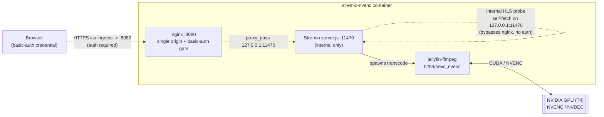

# stremio-nvenc

Self-hosted **Stremio streaming server** — the bundled Stremio web client + the
unmodified Stremio `server.js` + an nginx single origin + HTTP basic-auth —
re-based to a **glibc** base with an **NVENC-capable ffmpeg** so it can
hardware-transcode on an NVIDIA GPU. Validated by a live prototype on the
cluster's Tesla T4 (driver 570.195.03): `jellyfin-ffmpeg` 4.4.1-4 encodes
`h264_nvenc` + `hevc_nvenc` on a Debian/glibc base.

Derived from [tsaridas/stremio-docker](https://github.com/tsaridas/stremio-docker)
(MIT — see [`LICENSE`](./LICENSE)). Upstream's layout is carried over as-is: the
web-client build (`builder-web` stage), the `server.js` assembly, the nginx
single-origin proxy, the basic-auth wiring, and the entrypoint. Two deliberate
departures (below) re-base it to glibc + NVENC, and one security fix closes the
pre-auth torrent path.

## Why glibc + prebuilt NVENC ffmpeg (not upstream as-is)

- **glibc, not musl.** Upstream is Alpine (musl). NVIDIA's encode userspace
  (`libnvidia-encode`, `libnvcuvid`, `libcuda`, injected at runtime by the NVIDIA
  container toolkit) is **glibc-only** — on a musl base the encoder probe silently
  falls back to CPU. The final stage here is `debian:bullseye-slim` (glibc).
- **Prebuilt NVENC ffmpeg.** Upstream builds jellyfin-ffmpeg from source with
  VAAPI. This image drops that stage and installs Jellyfin's prebuilt
  `jellyfin-ffmpeg` **v4.4.1-4** `.deb` (ships `h264_nvenc` / `hevc_nvenc` /
  NVDEC-cuda). Binaries land at `/usr/lib/jellyfin-ffmpeg/{ffmpeg,ffprobe}`, and
  `FFMPEG_BIN` / `FFPROBE_BIN` point there so the Stremio server invokes the NVENC
  build. Encoder selection is **automatic**: the server probe-tests an
  `nvenc-linux` profile at startup and uses it when ffmpeg + GPU support it — no
  patching of `server.js` required.

## Request flow and the single-origin auth model



The web UI and the server share **one origin** (nginx :8080), so the browser
auto-attaches the cached basic-auth credential to every asset, API, HLS manifest,
and segment request — no CORS preflight, auth works on all streaming paths. The
server's **internal transcode probe** talks to itself on `127.0.0.1:11470` and
never traverses nginx, which is what makes authenticating the external paths safe
(see below).

## Security — the pre-auth torrent path is CLOSED (infra#80)

Upstream ships the torrent location
`location ~ "^/([a-zA-Z0-9]{40})/(-?[0-9]+)$"` (`/{infoHash}/{fileIdx}`) with
`auth_basic` **commented out**, so a stranger who guesses/derives an infohash can
make the box download and seed arbitrary torrents. This image **re-enables
basic-auth on that location** (in both `nginx/http.d/default.conf` and
`nginx/https.conf`). It is safe because the server's internal HLS transcode probe
self-fetches over `127.0.0.1:11470` and does **not** go through `nginx:8080`, so
gating the external path never breaks the probe (verified by the live prototype).
Basic-auth stays on `/hlsv2`, `/stream`, `/proxy`, the HLS manifest + segment
locations, and `/` exactly as upstream has them.

Auth is active only when **both** `USERNAME` and `PASSWORD` are set — the
entrypoint then generates `/etc/nginx/.htpasswd` and writes the `auth.conf` that
every gated `location` includes. With them unset, `auth.conf` stays empty and no
auth is applied (upstream behaviour).

## GPU runtime (set by the k8s Deployment, NOT the image)

NVENC needs the NVIDIA userspace libraries injected at container start. The image
does **not** bake these in — the Kubernetes Deployment must set:

```
NVIDIA_DRIVER_CAPABILITIES=all       # or at least compute,video,utility
```

The GPU operator injects only `compute,utility` by default; **NVENC needs
`video`** and the encoder probe's CUDA context needs `compute`. Also give the pod
a GPU (`resources.limits."nvidia.com/gpu": 1` or `NVIDIA_VISIBLE_DEVICES`).

## Ports

| Port  | What | Exposed |
|-------|------|---------|
| 8080  | nginx single origin (web UI + proxied server) | yes (`EXPOSE 8080`) |
| 11470 | Stremio `server.js` HTTP | internal only (nginx proxies to `127.0.0.1:11470`) |

## Environment variables

Only variables upstream defines are used (no invented vars). Key ones:

| Var | Default | Purpose |
|-----|---------|---------|
| `USERNAME` / `PASSWORD` | unset | If **both** set, enables HTTP basic-auth (htpasswd generated at start). If unset, no auth. |
| `NO_CORS` | `1` | Disable CORS enforcement in the server (single-origin behind nginx). |
| `AUTO_SERVER_URL` | `0` | `1` = auto-seed the web UI's streaming-server URL from the bundled `localStorage.json` (points the UI at its own origin). |
| `FFMPEG_BIN` | `/usr/lib/jellyfin-ffmpeg/ffmpeg` | NVENC ffmpeg the server invokes. |
| `FFPROBE_BIN` | `/usr/lib/jellyfin-ffmpeg/ffprobe` | ffprobe path. |
| `SERVER_URL` | unset | Explicit streaming-server URL for the web UI (alternative to `AUTO_SERVER_URL`). |

Other upstream vars are carried over unchanged: `IPADDRESS`, `DOMAIN`,
`CERT_FILE`, `APP_PATH`, `WEBUI_INTERNAL_PORT`, `WEBUI_LOCATION`, `CASTING_DISABLED`,
`DISABLE_CACHING`, `READABLE_STREAM`, and the `*_DEBUG` toggles. `IPADDRESS` /
`CERT_FILE` drive the optional self-managed HTTPS path (`certificate.js`); leave
them unset when TLS terminates at an upstream ingress/proxy (the deployment model
here — the container serves plain HTTP on 8080 behind Traefik).

## Node version

The final stage installs **Node 22 from NodeSource**, not the `nodejs` in the
bullseye apt repo. Bullseye ships Node 12, which lacks the global `fetch` /
`AbortController` that `certificate.js` relies on and is far older than upstream's
Alpine Node 22. NodeSource Node 22 matches upstream and bundles npm.

## Persistence

`server.js` always writes its cache/settings to `/root/.stremio-server/` (declared
as a `VOLUME`). Mount a PVC there for config persistence; transcode scratch is
regenerable and can be an ephemeral volume.

## Build

```
docker buildx build --platform linux/amd64 -t stremio-nvenc:dev .
```

Built in CI by `.github/workflows/build.yml` (off-infra on GitHub Actions per
ADR-0002) → `ghcr.io/viktorbarzin/stremio-nvenc:<sha8>` + `:latest` (private),
`linux/amd64`, `provenance: false`, keep-10 retention. The workflow's `deploy` job
is a **stub** pending onboarding (the Woodpecker mirror repo id is not yet known —
see the TODO in the workflow).

## Attribution

Based on tsaridas/stremio-docker, MIT © 2023 Andreas Tsarida. This image keeps the
upstream `org.opencontainers.image.source` label and MIT `LICENSE`.
